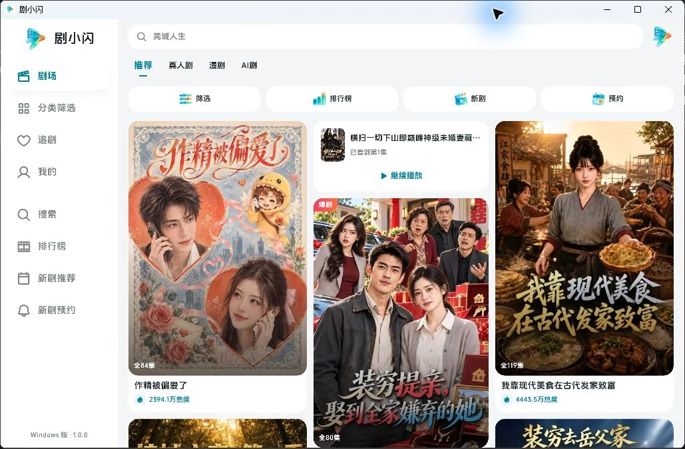
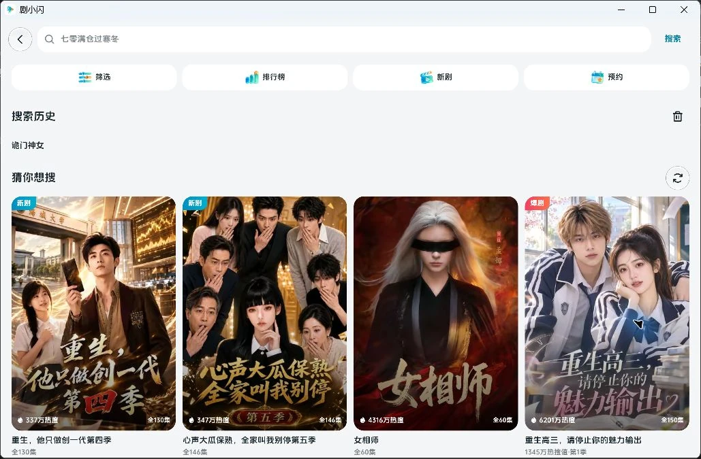
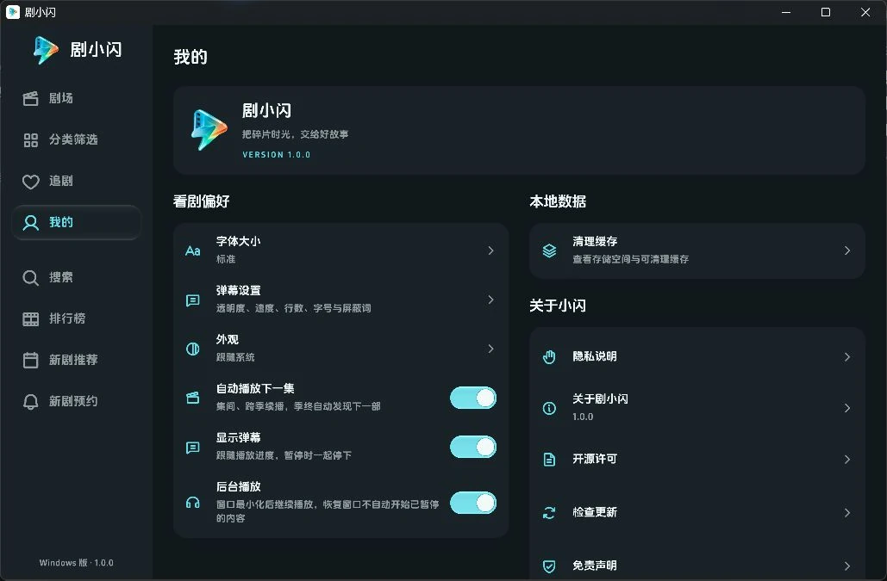
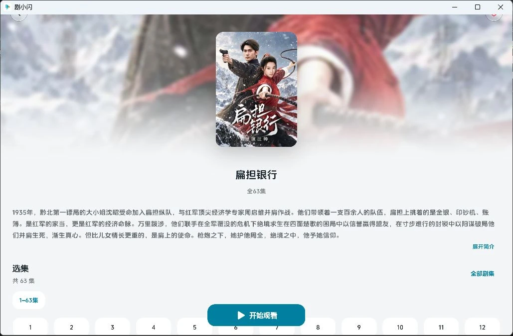

  <h1>&nbsp; 剧小闪</h1>
  
把碎片时光，交给好故事

  
Android · Windows ｜ 清透玻璃 · 弹幕陪伴 · 进度续播

  
<a href="https://github.com/ningyou8023/juxiaoshan/releases/latest">查看 Android / Windows 安装包</a>

剧小闪是一款为碎片时光打造的短剧应用。发现喜欢的故事，跟着弹幕一起入戏，随手收藏，下次从熟悉的地方继续看。

当前版本 **1.0.0**，现已完成 **Android 与 Windows 双端开发**。手机上随手看，电脑上用大屏追剧，熟悉的找剧、收藏、预约与播放体验，在两种设备上都能找到。

| 平台 | 系统要求 | 安装形式 |
| --- | --- | --- |
| Android | Android 7.0 及以上 | APK 安装包 |
| Windows | Windows 10 / 11，64 位 x64 | EXE 安装向导 |

两端的收藏、预约、观看进度与设置分别保存在当前设备，暂不支持跨设备同步。

**使用说明：仅供学习研究与技术交流，请支持正版，优先通过官方或已获授权的渠道观看。**

## 好故事，找起来更轻松

- **推荐与榜单一起看**：真人剧、漫剧、AI 剧与近期上新混排，错落排布的剧场搭配排行榜，既能随心浏览，也能按热度寻找感兴趣的作品。
- **想看的类型，细细筛**：分类筛选、热搜剧名和输入联想，让找剧更有方向。
- **新故事，提前关注**：新剧推荐、上新日历与预约入口，方便发现和记录想看的作品；详情页预约也会补齐接口公布的预计上线时间。

## 看剧，按自己的节奏

| 亮点 | 体验 |
| --- | --- |
| 一滑换集 | 上下滑动切换前后集，最后一集提前准备下一季或另一部好剧，自动接播不弹提示；待上线下一季的预约入口只在本季最后一集显示。 |
| 选集清楚 | 分季浏览、百集分段，正在观看的集数清晰标记，长篇故事也好找。 |
| 播放随心 | 横向画面可全屏观看，横屏左侧调亮度、右侧调系统音量，两侧均可锁定；倍速从按钮中央弹出玻璃菜单，自动换集也保留已打开的设置。 |
| 偏好记得住 | 选好的倍速与画质会保存，换剧和再次打开时继续沿用。 |
| 弹幕有陪伴 | 文字与表情图片一起滚动，可调透明度、速度、行数与字号，支持屏蔽词，清屏时同步隐藏弹幕。 |
| 字号更合适 | 标准与大号预览，确认后全局立即生效，找剧和追剧都更清楚。 |
| 系统无线投屏（Android） | 从播放器进入手机系统投屏页，连接兼容电视后投射手机画面，返回应用继续看。 |
| 收藏与续播 | 红心收藏、观看历史和进度续播；本季最后一集的进度条上方可预约或取消预约待上线的下一季，换季或换剧后收起旧预约入口。 |
| 预约上线提醒 | 启动或回到应用时检查真实上线状态，新上线作品合并提醒，可直接查看详情；提醒只展示一次，追剧预约中的“新上线”标记保留到观看。 |
| 多种屏幕，一起看 | Android 手机浏览保持竖屏，折叠屏和平板支持横竖切换，宽屏目录增加列数；Windows 使用侧边导航与自适应内容区，窗口可调整大小，兼顾笔记本与桌面显示器。 |
| 耳机继续听（Android） | 熄屏时连接耳机继续播放，未连接耳机暂停；亮屏或插入耳机后，沿用自己的播放选择。 |
| 后台媒体控制（Android） | 后台媒体卡片显示封面、剧名与集数，上一集／播放暂停／下一集／红心收藏均匀排列；同步真实时长、进度和缓冲，暂停后保留继续播放操作，返回应用收起通知。系统媒体面板支持拖动进度，最终样式与锁屏展示随手机系统变化。 |
| 切换应用继续看（Android） | 播放中切换其他应用时进入系统小窗，画面只保留视频，可用系统按钮暂停或继续；适用于支持画中画的 Android 8.0 及以上设备，后台音频可独立设置，暂停时不自动弹出小窗。 |

## 清透外观，细节也耐看

青蓝与薄荷绿点缀灰白页面，搭配统一的 Phosphor 粗线条与实心图标、透明液态玻璃导航和细腻的边缘反光。浅色清爽，深色沉静，紧凑的排版让封面与故事成为主角。

导航支持长按放大和左右滑动选择，开关带有透镜回弹动效；收藏、预约、倍速与画质操作都有顶部提示，查看反馈更顺手。收藏和观看记录保存在本机，熟悉的追剧习惯也跟着留下来。

启动页随横竖屏和窗口尺寸调整插画与文字，完整展示品牌画面；海报保留已加载的图片，让切换应用后的浏览更连贯。

Android 首次启动页结束后，会在需要时直接显示系统通知授权框；已有授权或已处理过申请的跳过。应用不再叠加权限说明弹窗、不自动打开设置页面，也不重复打扰。通知和锁屏展示沿用手机系统及用户选择。

## Windows，坐下来慢慢看

Windows 首版已经完成，提供独立的 **EXE 安装包**。从开始菜单或桌面快捷方式打开，就能进入熟悉的剧场。左侧导航常驻，剧场、分类、追剧和设置随手切换，搜索、排行榜、新剧与预约也能直接进入；窗口启动居中，尺寸可调，内容随可用空间重新排布。

- **大屏找剧更从容**：封面与文字按窗口宽度排布，搜索支持剧名联想、热榜和预约作品；分类、榜单、详情等页面可用鼠标拖动下拉刷新。
- **横屏播放更专注**：沿用手机横屏的顶部控制、白色进度条与玻璃选集栏，简介、选集和系列剧在同一个弹层中切换；双击画面或按 F 可切换全屏。
- **鼠标键盘都顺手**：滚轮切换前后集，方向键快进快退，快捷键调音量、弹幕与选集；输入文字或打开弹层时，操作遵循当前界面的焦点。
- **按自己的习惯看**：倍速、画质、弹幕、字号、浅深色和自动接播设置保存在本机；播放页左侧调画面亮度，右侧调应用音量，两侧均可锁定播放操作。
- **桌面上也有提醒**：Windows 同样支持启动公告、预约上线提醒与新版本提示；“忽略更新”保留 24 小时，到期后下次启动再次提醒。

| 常用操作 | 快捷键 |
| --- | --- |
| 打开搜索 / 切换主页面 | Ctrl + K / Ctrl + 1、2、3、4 |
| 返回 | Alt + ← |
| 播放、暂停 | 空格 |
| 快退、快进 5 秒 | ← / → |
| 上一集、下一集 | 滚轮上、下 / ↑、↓ / PageUp、PageDown |
| 调节应用音量 / 静音 | +、− / M |
| 弹幕 / 选集 / 锁定 | D / E / L |
| 切换全屏 | F / F11 / 双击视频 |

Windows 的画面亮度只影响当前播放画面，音量只影响剧小闪。手机系统投屏、Android 媒体通知和系统画中画为 Android 功能；Windows 暂未接入系统媒体卡片、托盘与桌面小窗。

## 界面预览

### Android

以下截图来自电脑上的 Android 14 模拟器，运行剧小闪 **1.0.0** 正式版，统一为 **1080 × 2400** 竖屏。剧场、筛选、排行榜、新剧和详情展示浅色外观，个人页展示深色外观，内容均为实际运行加载。

| 剧场 | 分类筛选 | 排行榜 |
| :---: | :---: | :---: |
|  |  |  |

| 新剧 | 分季与选集 | 我的与深色外观 |
| :---: | :---: | :---: |
|  |  |  |

### Windows

以下截图于 **2026 年 11 月 25 日**从 Windows 桌面版 **1.0.0** 实际运行截取，保留应用窗口与标题栏。展示浅色剧场、搜索、排行榜、详情，以及深色设置；剧目和榜单内容随服务实际返回变化。

| 桌面剧场 | 搜索推荐 |
| :---: | :---: |
|  |  |

| 排行榜 | 深色外观与偏好 |
| :---: | :---: |
|  |  |

<strong>剧集详情与选集</strong>

## 下载与更新

前往 [Releases](https://github.com/ningyou8023/juxiaoshan/releases/latest)，按设备选择对应安装包，以该版本提供的附件为准。

| 平台 | 安装包 | 安装方式 |
| --- | --- | --- |
| Android | `剧小闪-1.0.0.apk` | 下载后在手机上安装；后续版本可覆盖安装，保留本机记录。 |
| Windows | `剧小闪-Windows-1.0.0-Setup-x64.exe` | 运行安装向导，按提示允许管理员权限；默认创建桌面快捷方式并在完成后启动，可自行取消。 |

Windows 新安装默认位于 `C:\Program Files\Juxiaoshan`；更新时先退出应用，再运行新安装包，已有全机安装会沿用原目录覆盖，保留本机收藏、预约、进度与设置。请通过安装向导安装完整程序。

应用启动后会检查更新，也可以在 **我的 → 关于小闪 → 检查更新** 中手动查看。发现新版本时，会居中展示更新说明，选择“立即更新”前往下载，或选择“忽略更新”，在接下来的 **24 小时内** 暂停同一更新的自动提醒。满 24 小时后，下次启动应用会再次提示；手动检查仍可随时查看并更新，其他新版本也会正常提醒。

本仓库用于剧小闪的应用介绍、界面展示与版本发布。

Android 与 Windows 均支持应用公告：链接、彩色文字、字号与加粗，多条公告按顺序居中展示；正文可独立滚动，选择“关闭”结束本次展示，选择“今日不再弹出”可在当天隐藏当前公告。启动时按更新、公告、预约上线提醒的顺序展示，方便逐项查看。

**我的 → 清理缓存** 可查看本机存储空间、剧小闪占用及可清理的缓存。一键清理会移除封面缓存和闲置的视频临时文件，收藏、预约、观看进度与设置会继续保留。

## 免责声明

**一、应用与接口来源**

剧小闪是独立的第三方短剧浏览与播放应用。当前剧目目录、搜索、分集、播放地址、弹幕等内容数据经 openhongguo SDK 获取，该 SDK 对接的相关接口来源于红果短剧 App 的服务。标明来源只用于说明技术与内容出处，不表示这些接口已向本应用授予使用许可。

**二、独立关系与品牌标识**

剧小闪并非红果短剧官方客户端，与红果短剧、其运营主体、SDK 作者及作品权利人不存在已声明的官方隶属、代理、授权或合作关系。第三方名称、商标、Logo 和作品名称仅用于识别来源，不表示其推荐、认可或担保本应用。

**三、内容权利归属**

剧集、视频、海报、剧照、文字、声音、弹幕、人物形象及表情素材等内容的著作权、商标权、肖像权和其他权益，归各自权利人所有。第三方 SDK 或代码的开源许可不等于影视内容、接口、商标或素材的使用授权；各组件和素材的原始许可仍单独适用，见“开源许可”。

**四、功能与缓存范围**

本应用不提供用户上传影视内容、转售内容或二次发布的入口，不建立自有影视内容库。播放及海报展示可能产生本机临时缓存，缓存仅服务于当前使用体验，不代表取得复制、传播或商用权利。收藏、预约和观看记录仅用于本机体验，不代表向内容平台付费、购买版权或获得会员权益。

**五、使用边界**

本应用仅供学习研究与技术交流，请支持正版，优先通过官方或其他获得授权的渠道观看、付费及支持创作者。学习研究、免费或非商业使用本身不构成对影视内容、接口或素材的授权。

使用者应遵守适用法律、作品授权范围及相关平台的服务规则，确认自身具备访问与使用内容的合法依据。不得将内容或接口用于未经许可的录制、下载、转载、传播、售卖、广告经营、批量采集、绕过付费或访问限制等活动。

**六、第三方服务与可用性**

作品资料、上线排期、热度、弹幕及播放结果以第三方服务实际返回为准，可能因接口调整、网络、地区、账号、设备、授权范围或内容下架而变化。剧小闪不对第三方资料的完整性、准确性、持续可用性或适合特定用途作保证；界面显示也不构成投资、交易、版权状态或上线时间的承诺。第三方链接、下载页面及其条款由对应服务方提供，请在访问前自行核对来源与相关说明。

**七、数据与隐私提示**

请求第三方服务需要传递接口所需的作品标识、网络及设备相关参数，第三方对这些请求的处理适用其自身规则。本机收藏、进度、偏好及缓存可通过应用内入口管理。提交问题时请先脱敏，避免公开身份资料、访问令牌、临时播放地址或他人的个人信息。本说明不替代应适用的隐私说明及第三方隐私政策。

**八、权利投诉与处理**

如认为本应用展示的内容、标识、素材或功能涉及侵权，请通过本仓库的 [Issues](https://github.com/ningyou8023/juxiaoshan/issues) 发起联系，提供脱敏的作品名称或标识、涉及位置、权利类型、具体诉求及有效联系方式；权属证明或代理授权等敏感材料请在确认的私密渠道补充。维护者收到线索后会核实，并依据核实结果采取移除展示、停用相关功能、修正说明或联系内容来源方等处理。请勿在公开 Issues 上传身份证件或未经许可的完整作品。

**九、责任与说明范围**

本说明旨在解释来源、权利及使用边界，不是版权许可、法律意见，也不保证消除侵权争议；声明来源或标注“免责”不替代所需授权。本说明不排除或限制依法应承担的责任，也不影响使用者及权利人依法享有的权利。使用中如对权利范围存在疑问，请停止相关使用并向权利人或专业人士核实。

## 鸣谢

- **[openhongguo](https://github.com/beilunyang/openhongguo)**：感谢该 SDK 提供剧目目录、搜索、分集与播放能力，保留原作者声明及 Apache-2.0 许可证。
- **[liquid_glass_widgets](https://github.com/sdegenaar/liquid_glass_widgets)**：透明液态玻璃组件与渲染。
- **[media_kit](https://github.com/media-kit/media-kit)**：音视频播放支持。
- **[Phosphor Icons](https://github.com/phosphor-icons/core)**：统一的粗线条与实心图标；字体取自 [phosphor_icons 3.0.1](https://github.com/funccloud/phosphor-icons)，保留 MIT 声明。
- **[douyin-emoji](https://github.com/hnlyzxf/douyin-emoji)**：弹幕表情资源与名称映射；素材权利归原权利人，保留上游使用声明，详见应用内开源许可。

依赖声明可在应用内“我的 → 开源许可”查看。内容及图片归各自权利人所有。
