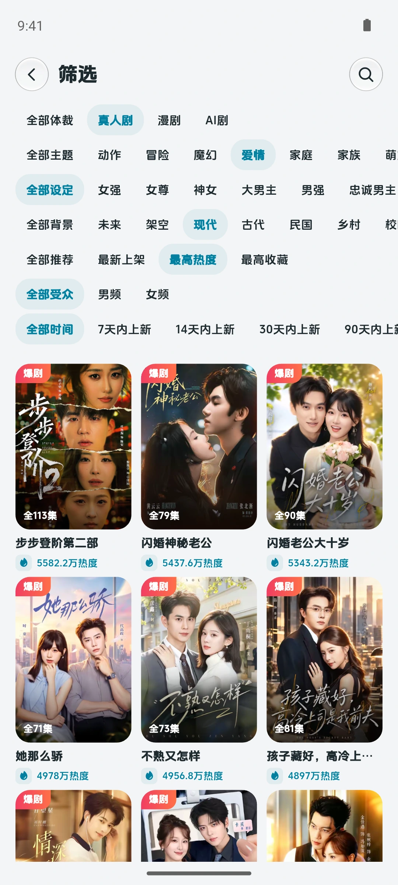
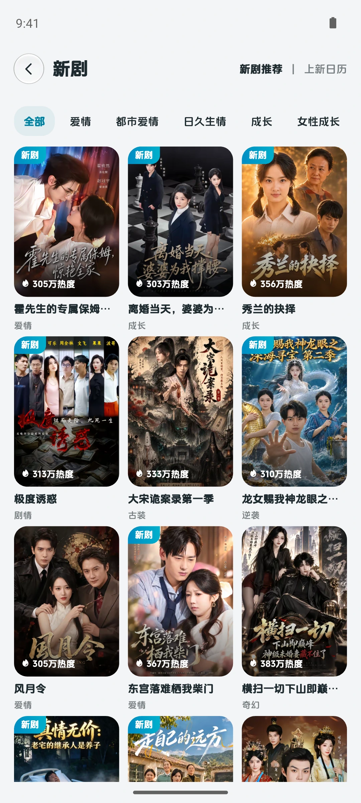
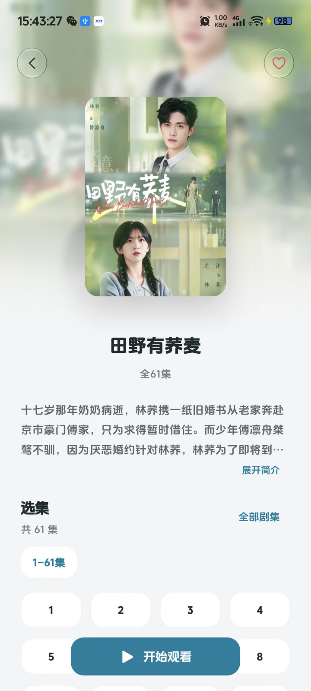
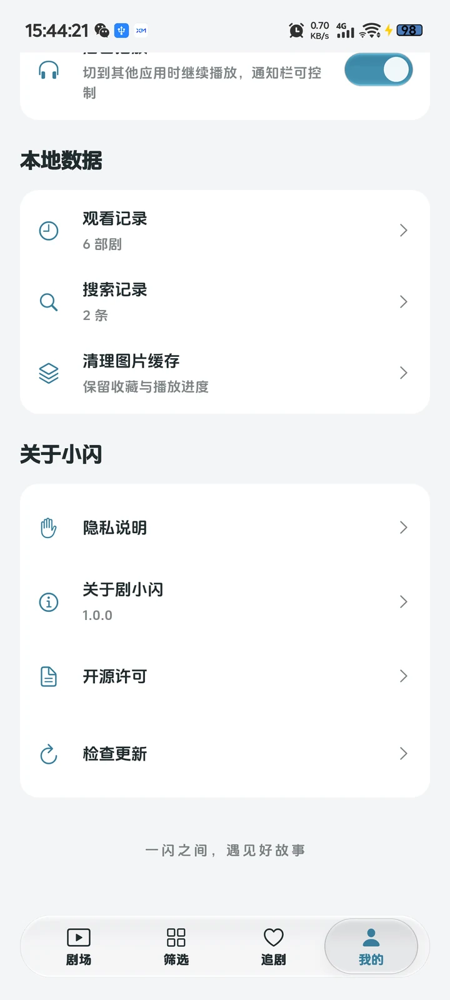

  <h1>&nbsp; 剧小闪</h1>
  
把碎片时光，交给好故事

  
清透玻璃 · 一滑换集 · 弹幕陪伴 · 进度续播

  
<a href="https://github.com/ningyou8023/juxiaoshan/releases/latest">下载 Android 安装包</a>

剧小闪是一款为碎片时光打造的短剧应用。发现喜欢的故事，跟着弹幕一起入戏，随手收藏，下次从熟悉的地方继续看。

当前版本 **1.0.0**，支持 **Android 7.0 及以上**。下载一个安装包，即可开始你的追剧时光。

## 好故事，找起来更轻松

- **推荐与榜单一起看**：错落排布的双列剧场搭配排行榜，既能随心浏览，也能按热度寻找感兴趣的作品。
- **想看的类型，细细筛**：分类筛选、热搜剧名和输入联想，让找剧更有方向。
- **新故事，提前关注**：新剧推荐、上新日历与预约入口，方便发现和记录想看的作品。

## 看剧，按自己的节奏

| 亮点 | 体验 |
| --- | --- |
| 一滑换集 | 上下滑动切换前后集，支持自动连播，让故事顺着看下去。 |
| 选集清楚 | 分季浏览、百集分段，正在观看的集数清晰标记，长篇故事也好找。 |
| 播放随心 | 横竖屏切换、倍速和画质选择，长按快进或回退，按自己的节奏观看。 |
| 偏好记得住 | 选好的倍速与画质会保存，换剧和再次打开时继续沿用。 |
| 弹幕有陪伴 | 弹幕跟随播放进度，竖屏两行、横屏三行，也可以随时关闭。 |
| 收藏与续播 | 红心收藏、观看历史和进度续播，让喜欢的故事随时接得上。 |
| 切换应用继续看 | 支持系统画中画与后台播放，按需要选择观看方式；画中画适用于 Android 8.0 及以上。 |

## 清透外观，细节也耐看

青蓝与薄荷绿点缀灰白页面，搭配白底圆角图标、透明液态玻璃导航和细腻的边缘反光。浅色清爽，深色沉静，紧凑的排版让封面与故事成为主角。

导航支持长按放大和左右滑动选择，开关带有透镜回弹动效；收藏、选集与播放入口各有清晰反馈。收藏和观看记录保存在本机，熟悉的追剧习惯也跟着留下来。

## 界面预览

以下为 Android 真机界面。

| 剧场 | 分类筛选 | 排行榜 |
| :---: | :---: | :---: |
|  |  |  |

| 新剧 | 剧集详情 | 我的与更新 |
| :---: | :---: | :---: |
|  |  |  |

## 下载与更新

前往 [Releases](https://github.com/ningyou8023/juxiaoshan/releases/latest) 下载 **剧小闪-1.0.0.apk** 并安装。后续版本可覆盖安装，继续保留本机收藏与观看进度。

应用启动后会检查更新，也可以在 **我的 → 关于小闪 → 检查更新** 中手动查看。发现新版本时，会居中展示更新说明，选择“立即更新”前往下载，或选择“忽略更新”稍后再说。

本仓库用于剧小闪的应用介绍、界面展示与版本发布。

## 鸣谢

- **[openhongguo](https://github.com/beilunyang/openhongguo)**：感谢该 SDK 提供剧目目录、搜索、分集与播放能力，保留原作者声明及 Apache-2.0 许可证。
- **[liquid_glass_widgets](https://github.com/sdegenaar/liquid_glass_widgets)**：透明液态玻璃组件与渲染。
- **[media_kit](https://github.com/media-kit/media-kit)**：音视频播放支持。

依赖声明可在应用内“我的 → 开源许可”查看。内容及图片归各自权利人所有。
