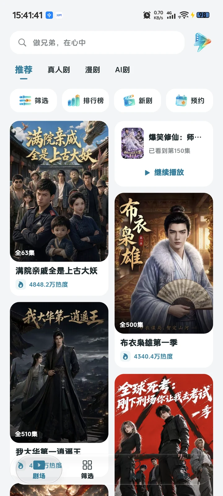

  <h1>&nbsp; 剧小闪</h1>
  
把碎片时光，交给好故事

  
Flutter · 透明液态玻璃 · 浅色 / 深色 · 本地追剧

  
<a href="https://github.com/ningyou8023/juxiaoshan/releases/latest">下载 Android 安装包</a>

剧小闪是一款使用 Flutter 开发的短剧应用。用紧凑的布局、青蓝与薄荷配色和清透玻璃导航，让找剧、追剧与分集播放自然衔接。

当前版本 **1.0.0 · 4011**。Android 最低支持 **7.0 / API 24**，提供一个兼容 `armeabi-v7a`、`arm64-v8a`、`x86_64` 的通用 APK。iOS 工程部署目标为 **15.0**，需在 macOS 上构建，尚未完成 iOS 真机验证。

## 界面预览

以下图片来自 Android 真机，截图仅作界面展示。

| 剧场 | 分类筛选 | 排行榜 |
| :---: | :---: | :---: |
|  |  |  |

| 新剧 | 剧集详情 | 我的与更新 |
| :---: | :---: | :---: |
|  |  |  |

## 功能

- **找剧**：两列错落推荐、排行榜、分类筛选、热搜轮换、输入联想与搜索。
- **追剧**：本地收藏、观看历史、进度续播、新剧日历与预约。
- **观看**：分季选集、百集分段、上下滑动切集、自动连播、清晰度和倍速偏好。
- **播放体验**：真实弹幕、横竖屏、长按快进回退、Android 系统画中画与后台媒体控制。
- **清透外观**：透明 Logo、玻璃导航与开关、白色边缘反光、浅深色适配和固定项目字体。
- **应用更新**：启动页结束后后台检查；“我的 → 关于小闪 → 检查更新”可手动查询。发现新版本时居中显示说明，提供“立即更新”和“忽略更新”。

内容目录、热度、封面、分集和可播地址使用 SDK 的真实返回，服务可用性以实际请求为准。预约与观看数据保存在本机，不代表服务端推送订阅。

## 安装与更新

到 [Releases](https://github.com/ningyou8023/juxiaoshan/releases/latest) 下载 **剧小闪-1.0.0.apk**。相同签名的新版本可直接覆盖安装，保留本地收藏与进度。

应用读取 GitHub `main` 分支根目录的 [`version.json`](version.json)，通过 ghproxy 访问 Raw 并追加时间戳；“立即更新”在浏览器打开元数据中的下载页面。支持 `buildNumber`，版本名相同时仍可比较构建号。忽略的版本不会在下次启动重复提示，手动检查仍可显示，更新版本号或构建号后会再次提醒。

本仓库用于应用介绍、界面展示和更新信息发布。应用源码保存在本地项目中。

## 鸣谢

- **[openhongguo](https://github.com/beilunyang/openhongguo)**：感谢该 SDK 提供 Flutter / Go 的目录、搜索、分集与播放能力。本项目使用固定源码兼容版，保留原作者声明及 Apache-2.0 许可证。
- **[liquid_glass_widgets](https://github.com/sdegenaar/liquid_glass_widgets)**：透明液态玻璃组件与渲染。
- **[media_kit](https://github.com/media-kit/media-kit)**：跨平台音视频播放。

其他依赖与声明可在应用内“我的 → 开源许可”查看。内容及图片归各自权利人所有；使用 SDK 时请遵循上游说明与条款。
